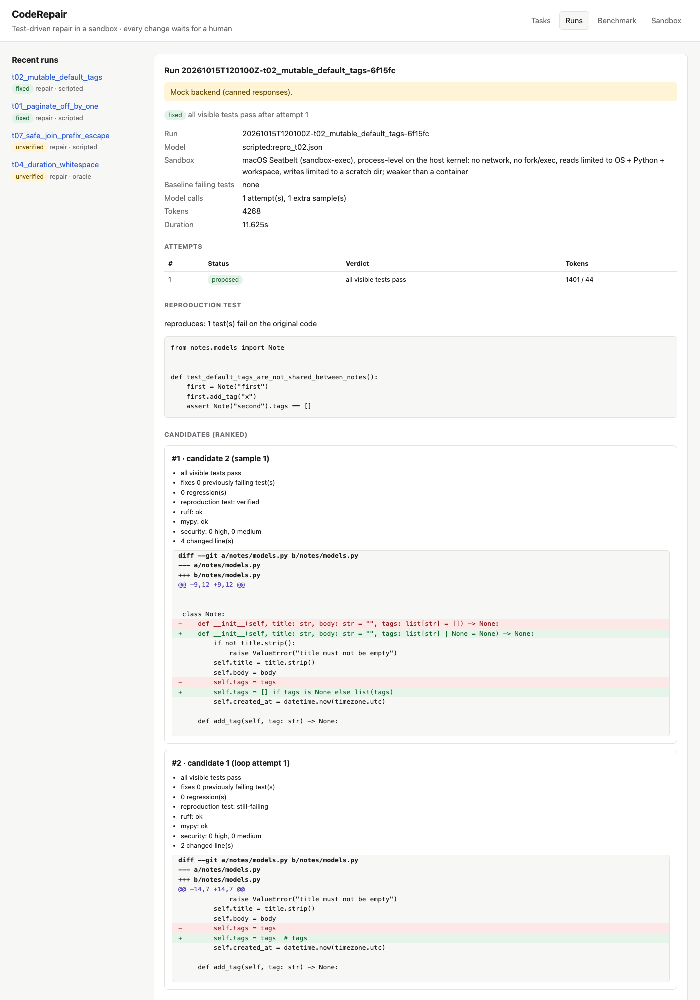
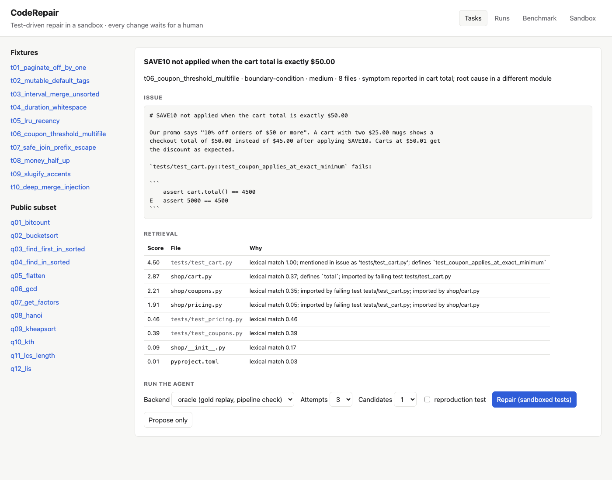

# CodeRepair

A constrained coding agent for small Python repositories. It reads an authorized issue, finds the
relevant files, proposes a minimal patch, **tests it in a sandbox**, iterates on the failures, ranks
the candidates, and hands a human a reviewable diff. It never merges, pushes or runs `git`, and
nothing reaches a repository without an explicit approval.

**Focus:** verifiable, test-driven repair with strong isolation and transparent evaluation.

```
issue + repo ─► retrieval with reasons ─► model ─► validated edits ─► sandboxed tests ─┐
                                            ▲                                          │
                                            └──── escaped, redacted feedback ◄─────────┘
                          ranked candidates (tests, reproduction test, lint/types, security review)
                                   ─► human review ─► approve ─► apply (no git, no push)
```

## Highlights

- **Two sandbox backends, one contract.** Docker (`--network none`, non-root, read-only rootfs and
  workspace, tmpfs, CPU/memory/pids limits, no capabilities) and a macOS Seatbelt fallback
  (deny-by-default profile, rlimits, memory and disk watchdogs). Pytest comes from a
  content-addressed, read-only runner bundle, so the image is stock CPython and nothing is downloaded
  at test time. 15 hostile probe suites (exfiltration, fork bombs, memory/disk/output floods, reading
  other processes' environments, forged results…) are contained, and negative controls prove the
  probes would notice an escape.
- **Untrusted results stay untrusted.** Results files are size-capped, nonce-checked,
  FIFO/symlink-safe and must agree with the exit status; missing tests count as failures; "fixed"
  requires the previously failing tests to pass, not to disappear.
- **A repair loop that learns from the harness, not from the repo.** Baseline → targeted tests →
  full suite → feedback (anchor hints from the real file, escaped and redacted test output) under
  attempt, token and time budgets.
- **Ranking you can read.** Candidates are scored on visible tests, regressions, a model-written
  *reproduction test* that must fail on the original code, newly introduced lint and type errors
  (ruff/mypy on throwaway copies, never importing the code), and an AST security review of the diff.
- **A real approval gate.** Approvals record reviewer, time and diff hash; `apply` re-verifies the
  repository byte-for-byte and writes files without git. A patch that passes every hidden test but
  adds `os.system("curl … | sh")` is stopped (see the demo).
- **Honest evaluation.** 10 first-party seeded-bug tasks plus 25 tasks derived from QuixBugs (MIT),
  hidden tests, leakage checks on every prompt, and a comparative benchmark of three agents (plus
  an ablation) under equal budgets, with confidence intervals and exact paired tests.

## Status

| Milestone | State |
|---|---|
| M1 fixtures, ingestion, issue parsing, read-only search, patch proposal, diff display | done |
| M2 disposable, network-less test sandbox with abuse probes | done (Seatbelt on macOS; Docker run for real under Colima: probes 15/15, 35/35 tasks valid) |
| M3 iterative repair loop | done |
| M4 candidates, reproduction tests, lint/type/security checks, human approval | done |
| M5 comparative benchmark (direct vs retrieval vs test-feedback) | done: two local 3B models plus an ablation, two Claude models through OpenRouter, and a 9-task hard tier (see below) |
| M6 licensed public subset (QuixBugs) with leakage controls | done |
| M7 dashboard, CI, threat model, docs, demo | done (GitHub Actions has not run: no remote; its steps pass in a local Linux VM on Python 3.11–3.13) |

Progress log with test results per milestone: [PROGRESS.md](PROGRESS.md).

## Quickstart

Requires Python ≥ 3.11 and [uv](https://docs.astral.sh/uv/). Test execution needs Docker (with
`python:3.12-slim` pulled) or macOS; without either, CodeRepair refuses to run repository code.

```bash
uv sync --all-extras
uv run coderepair sandbox status && uv run coderepair sandbox selftest
uv run coderepair tasks                                   # 10 fixtures, 25 public, 9 hard tasks
uv run coderepair repair t01_paginate_off_by_one --evaluate          # oracle mock by default
uv run coderepair repair t02_mutable_default_tags --backend scripted \
    --script docs/demo/repro_t02.json --candidates 2 --repro-test   # reproduction-test ranking
uv run coderepair review <run-id> && uv run coderepair approve <run-id> --reviewer you
uv run coderepair bench --backend oracle --suite all --tasks t01_paginate_off_by_one q06_gcd
uv run coderepair bench --backend openrouter --suite hard --max-cost-usd 1   # needs OPENROUTER_API_KEY
uv run coderepair bench-report docs/results/m5v2_*.jsonl          # CIs + paired tests, pooled by task
uv run coderepair serve                                   # dashboard on http://127.0.0.1:8000
uv run pytest -rs
```

The walkthrough with real output is in [docs/DEMO.md](docs/DEMO.md).

| Run detail: reproduction test, ranked candidates, diffs | Task view: issue and retrieval with reasons |
|---|---|
|  |  |

## Backends

| Backend | What it is | Use |
|---|---|---|
| `oracle` | **Mock.** Replays the task's gold solution | Pipeline checks. Never a repair result |
| `scripted` | **Mock.** Replays canned responses from a JSON file | Tests and adversarial demos |
| `anthropic` | Claude via the official SDK (default `claude-opus-5-5`), structured JSON output | Needs `ANTHROPIC_API_KEY` or an `ant auth login` profile. Not run live here (no key) |
| `ollama` | Local model via Ollama, JSON-schema output; `sample_index` > 0 samples at temperature 0.7 | Offline real runs; nothing leaves the machine |
| `openrouter` | Hosted models through OpenRouter (default `anthropic/claude-sonnet-5.5`), strict JSON-schema output, routed only to endpoints that honour every parameter and (by default) neither store nor train on prompts. Sends `temperature`/`seed` only when the model accepts them (Claude models accept neither) and records the provider-reported cost of every call | Needs `OPENROUTER_API_KEY` in `.env`. Repository excerpts leave the machine. `bench --max-cost-usd` caps spending |

Configuration is environment-only; see [.env.example](.env.example).

## Measured

Comparative benchmark (M5), 35 tasks, at most 3 model calls per agent per task, hidden tests scored
in the sandbox. Two local 3B models through Ollama and two Claude models through OpenRouter.
Resolved tasks with 95% Wilson intervals:

| Agent | `qwen2.5:3b` | `qwen2.5-coder:3b` | Claude Haiku 5.5 | Claude Sonnet 5.5 |
|---|---|---|---|---|
| direct (no retrieval, no tests) | 4/35 (5–26%) | 3/35 (3–22%) | 35/35 (90–100%) | 35/35 (90–100%) |
| retrieval (ranked context, no tests) | 4/35 (5–26%) | 7/35 (10–36%) | 34/35 (85–99%) | 35/35 (90–100%) |
| feedback (retrieval + sandboxed test loop) | 2/35 (2–19%) | 5/35 (6–29%) | 35/35 (90–100%) | 35/35 (90–100%) |
| feedback-sampled (ablation: the loop's retries sampled) | 5/35 (6–29%) | 5/35 (6–29%) | not run¹ | not run¹ |

¹ Claude models on OpenRouter accept no `temperature`, so `feedback-sampled` would send exactly the
requests `feedback` sends.

Neither end of the range ranks the agents. The Claude runs saturate: Sonnet resolved all 105
(task, agent) pairs on its first call and Haiku 104 of 105, so this task set is **too easy for
current hosted models to separate the designs**. The first-party fixtures saturate as well as the
public QuixBugs tasks, so this is not only memorisation. Provider-reported cost for the 105 rows:
$0.054 (Haiku) and $0.76 (Sonnet), which matches the change in the key's usage.

**Hard tier** (9 tasks on one shared 80k-character billing library, with misleading issues and
regression traps; see [BENCHMARK.md](BENCHMARK.md)): both Claude models resolve 8/9 with
`direct`, 6/9 with `retrieval` and 6/9 with `feedback`, failing on exactly the same tasks. Every
failure is missing context: the file to fix was not in the prompt (retrieval's top three missed it
three times; `direct`'s 60k-character window missed it once), and the model returned no edit
rather than guess. With the right file in view, both models fixed every bug on the first call,
traps included. The weakest component is retrieval, not reasoning or test feedback.

The 3B models are too weak to rank the agents: no pairwise difference is significant (smallest
p = 0.125, exact paired test by task over both models), so this does **not** show that test
feedback resolves more issues. What the run does show: at temperature 0 the test-feedback loop
never turned a failed first attempt into a fix (0 of 63), and the gap between retrieval and feedback
came from retrieval's temperature-0.7 resamples, which the `feedback-sampled` ablation was added to
isolate. Details, per-task results and caveats: [BENCHMARK.md](BENCHMARK.md).

Other measurements: retrieval recall@1 0.90 / recall@3 1.00 on the fixtures (random: 0.26 / 0.77;
the repos have 3–5 source files, so this mostly shows the plumbing works); all 35 tasks validate in
both sandboxes; gold patches resolve and buggy repos fail for every task.

## Security posture

- Repository code, model-written patches and model-written tests run **only** inside the sandbox.
  The single exception is validating the first-party fixtures, which may run on the host on a temp
  copy with a scrubbed environment.
- Repositories are read into an in-memory snapshot (allowed roots, `$HOME` and credential directories
  denied, no symlinks, secrets skipped before reading). `git` is never run on them.
- Model output is parsed as data: exact search/replace edits under a path policy (tests, CI, build
  and conftest files protected, no new files), all-or-nothing, syntax-checked.
- Everything untrusted that goes back into a prompt (issue, files, test ids, test output) is fenced,
  tag-escaped, redacted and scanned for injection.
- The dashboard binds to loopback, checks `Host` and `Origin`, accepts only JSON for state changes,
  sends a strict CSP and renders text with `textContent`.

Threat model (19 threats, residual risks included): [ARCHITECTURE.md](ARCHITECTURE.md).

## Layout

```
src/coderepair/
  repo.py security.py issue.py search.py retrieval.py prompting.py patch.py   read-only pipeline (M1)
  agent.py          context + one model call + validation
  sandbox/          Docker and Seatbelt backends, runner bundle, results parsing, probes (M2)
  execution.py      the only path that runs repository code
  loop.py           repair loop (M3)
  candidates.py checks.py approval.py                                        ranking and approval (M4)
  benchmark/        tasks, oracle, validator, hidden-test evaluation, comparative benchmark (M5)
  cli.py api.py static/                                                      CLI and dashboard (M7)
benchmarks/tasks/   10 first-party seeded-bug tasks
benchmarks/public/  25 QuixBugs-derived tasks (MIT; see LICENSE_NOTES.md)
benchmarks/hard/    9 hard-tier tasks, built from benchmarks/hard_src by build-hard-suite
scripts/            public-subset builder, M1 smoke run
docs/               demo, demo inputs, recorded results
tests/              unit, security, sandbox, loop, review, public-suite and API tests
```

## Documentation

[PLAN.md](PLAN.md) · [PROGRESS.md](PROGRESS.md) · [ARCHITECTURE.md](ARCHITECTURE.md) ·
[TESTING.md](TESTING.md) · [BENCHMARK.md](BENCHMARK.md) · [LICENSE_NOTES.md](LICENSE_NOTES.md) ·
[docs/DEMO.md](docs/DEMO.md)

The project license has not been chosen yet (see LICENSE_NOTES.md).
